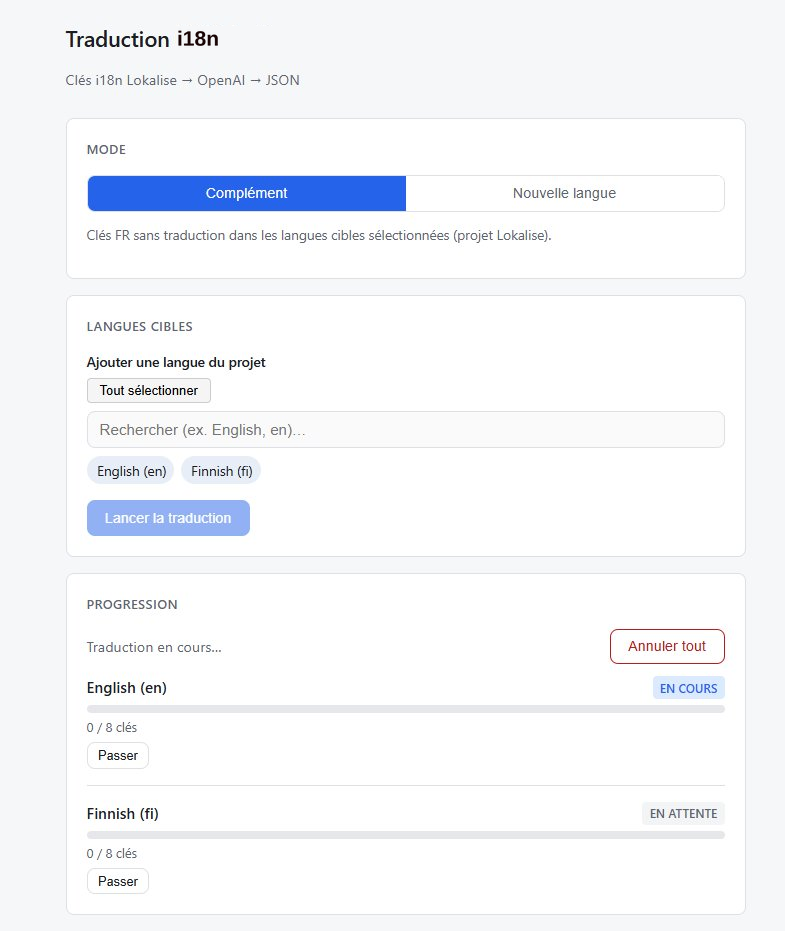

# LLM Translation Pipeline

Automated translation pipeline for mobile app localization. It replaces a manual workflow and avoids a €12,000 per year SaaS licence.

This repository documents the scope and the approach. The source code is not published.

## Context

Translating a mobile app into 8 languages meant either:
- copy-pasting strings into a general translation engine, with no context and a lot of manual work; or
- paying for the localization platform's AI add-on, at €12,000 per year.

This tool automates the middle path: fetch the untranslated strings from the localization platform, translate them with an LLM that knows the product context, and produce one file per language, from a small web interface.

## How it works

1. Fetch the untranslated strings from the **Lokalise API** (two modes: complete missing keys, or add a new language).
2. Send them to the **OpenAI API** (`gpt-4o-mini`) with domain context (IoT energy management, UI copy, product vocabulary).
3. Write one JSON file per target language, downloadable from the web interface, with progress per language and the ability to skip or cancel a language.
4. Import the files back into Lokalise for review and release.

## Stack

- **Python**: core pipeline
- **FastAPI**: REST API and job handling
- **OpenAI API**: translation engine
- **Lokalise API**: translation management
- **Render**: cloud deployment

## Design choices

- Context in the prompt: the product domain and UI constraints are given to the model, which is what makes the output usable without a full manual rewrite.
- A human review step stays in the loop: the tool produces files, it does not publish translations.
- Protected routes: starting, cancelling or skipping a translation requires an API key, since each run consumes API credits.
- Secrets live in environment variables only.

## Impact

- Removed a €12,000 per year licence.
- Translation cycle reduced from hours to minutes.
- Covers 8 languages and is used for every feature release (4 to 5 a year) and for each new language onboarding (1 to 2 a year).
- Deployed and used in production.

## Author

Built autonomously as a product-manager-led initiative to replace external tooling with a tool fitted to the need.
